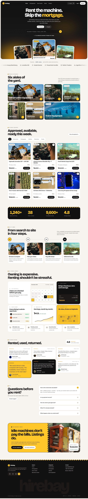
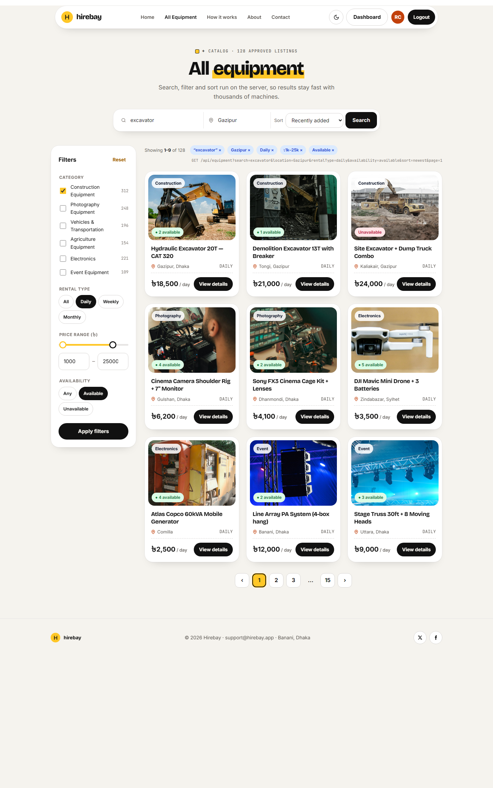
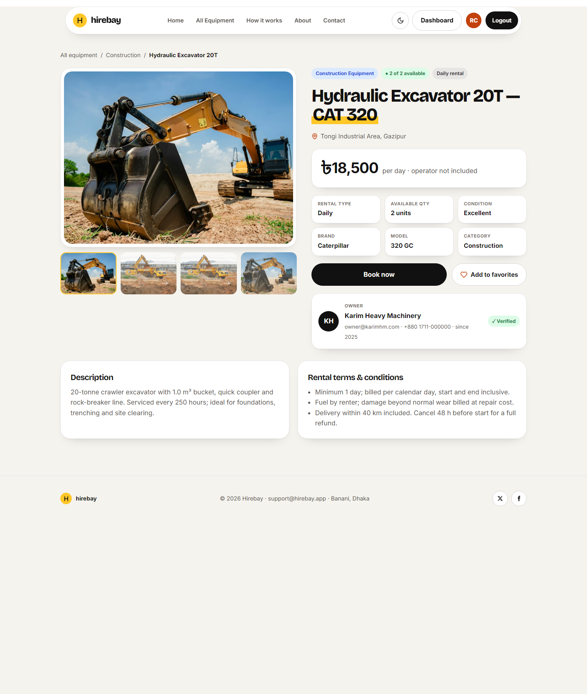
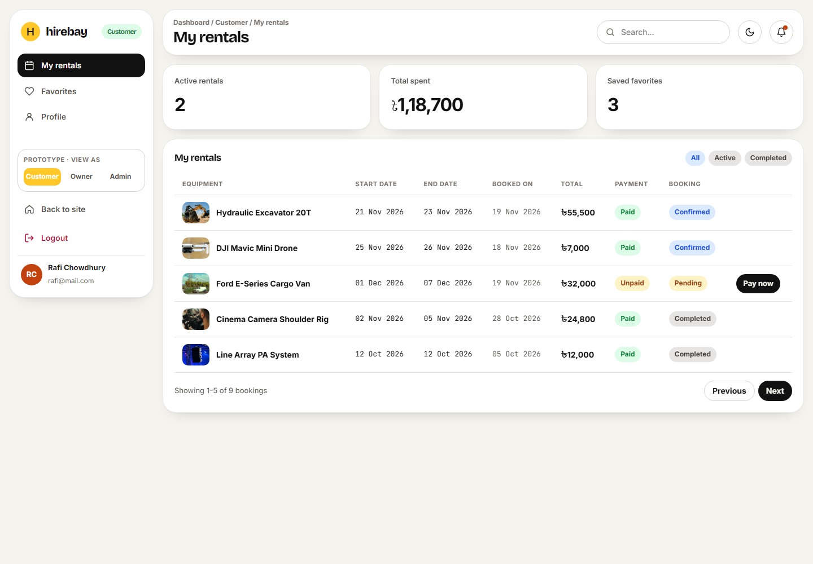
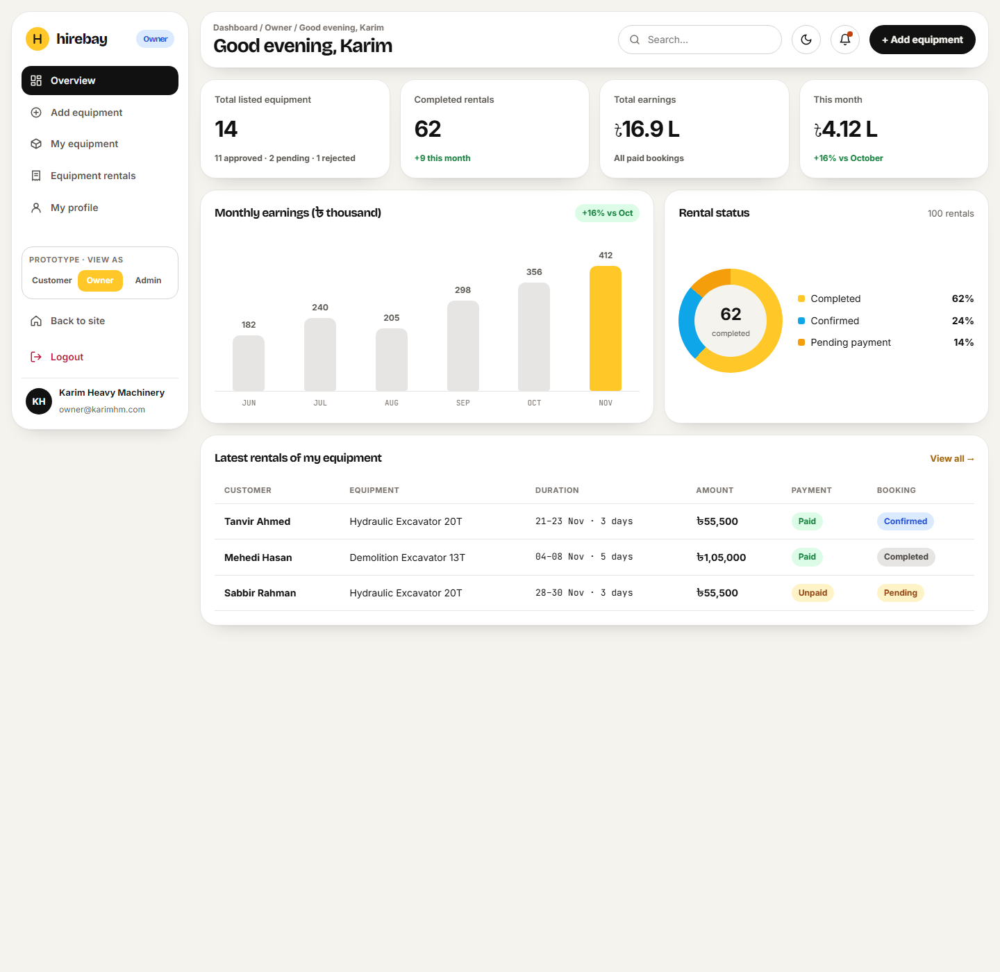
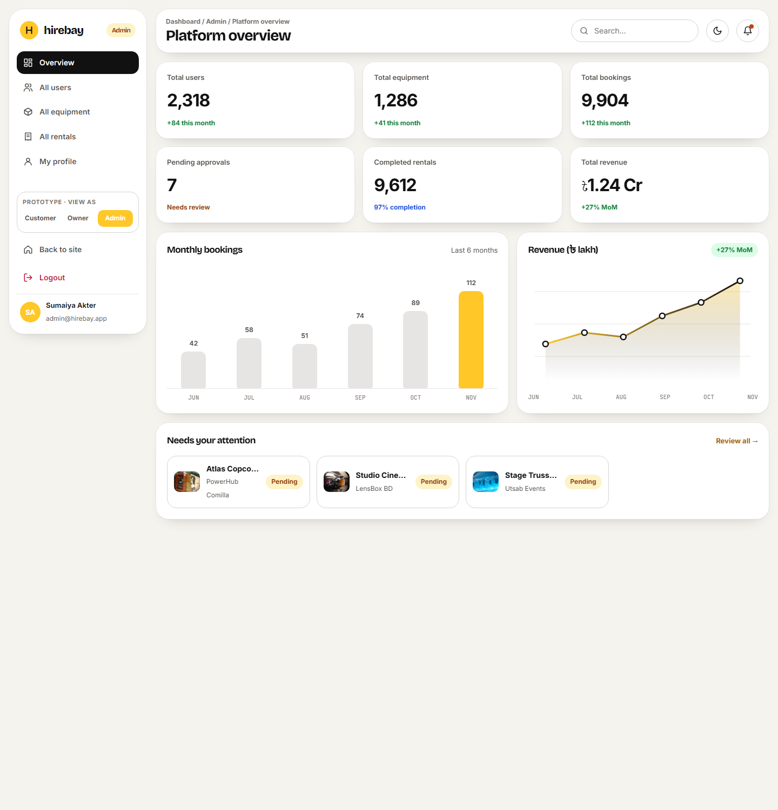

# Hirebay

Hirebay — equipment rental platform. Owners list equipment, an admin approves it, customers browse, favorite, book and pay with Stripe. The booking is confirmed only after successful payment.

- Live site: `https://hirebay-client.vercel.app`
- API: `https://hirebay-server.vercel.app` ([hirebay-server repo](https://github.com/jotika-meaw/hirebay-server)) · [hirebay-client repo](https://github.com/jotika-meaw/hirebay-client)

## Demo accounts
| Role | Email | Password |
|---|---|---|
| Admin | admin@hirebay.app | Hbpz9gp8FUa9 |
| Owner | karim@hirebay.test | DemoPeXhnrx1 |
| Owner | lensbox@hirebay.test | DemoPeXhnrx1 |
| Customer | rafi@hirebay.test | DemoPeXhnrx1 |
| Customer | nusrat@hirebay.test | DemoPeXhnrx1 |

- Stripe test card: 4242 4242 4242 4242, any future expiry date, any CVC.
- Demo data is shared — please don't delete other users' listings.

## Key features

**Everyone:** fluid-gradient planner hero, server-side catalog search/filters/sort/pagination, equipment details, stats band, reviews + FAQ, owner CTA, light/dark theme, ⌘K command search.

**Customers:** email/Google signup as Renter, favorites with heart state, booking modal with live total, Stripe Checkout, success/cancel pages, My Rentals (incl. "Pay now" on live holds), profile editing.

**Owners:** overview analytics (KPIs, monthly earnings, status donut), add equipment (imgbb upload or URL), my-equipment table (update → back to Pending, delete with confirm), rentals of own equipment.

**Admins:** platform analytics, all-users management (role change with confirm, remove; cannot change/remove self), equipment moderation (approve/reject/update/delete), all-rentals with status changes.

## Screenshots








## Packages

- `next` — App Router (route groups, server components, `src/proxy.js` guards).
- `react` / `react-dom` — UI runtime.
- `tailwindcss` + `tw-animate-css` + `@tailwindcss/turbopack` — Yard design tokens, utilities, animations.
- `next-themes` — light (default) / dark theme, saved in localStorage.
- `@base-ui/react` + `shadcn` primitives — buttons, dialogs, forms, tables, charts-ready cards.
- `better-auth` (+ `mongodb` adapter) — email/password + Google signup, sessions, roles.
- `axios` — API client with JWT interceptor (in-memory token cache, one 401 retry).
- `@tanstack/react-query` — server state behind `src/lib/data/hooks.js`.
- `react-hook-form` + `@hookform/resolvers` + `zod` — forms + validation (incl. BD phone, password rule).
- `motion` (`motion/react`) — entrance/hover animation (reduced-motion aware).
- `recharts` — owner/admin analytics charts.
- `cmdk` — ⌘K command menu.
- `sonner` — toasts.
- `lucide-react` — icons (plus the inline X logo).
- `@number-flow/react` — animated stat numbers.
- `date-fns` — date display (`21 Nov 2026`).
- `jsonwebtoken` — dev-only token helper (tests); the real JWT comes from the server bridge.

## Env vars (names only — values never committed; see `.env.example`)

`NEXT_PUBLIC_API_URL`, `NEXT_PUBLIC_DATA_SOURCE`, `BETTER_AUTH_URL`, `BETTER_AUTH_SECRET`, `MONGODB_URI`, `DB_NAME`, `GOOGLE_CLIENT_ID`, `GOOGLE_CLIENT_SECRET`, `JWT_SECRET`, `JWT_ISSUER`, `JWT_AUDIENCE`, `NEXT_PUBLIC_IMGBB_KEY`, `SEED_ADMIN_EMAIL`, `SEED_ADMIN_PASSWORD`, `SEED_USER_PASSWORD`.

## Run locally + seed

```bash
npm run dev     # next dev on :3000 (needs .env.local, DB_NAME=hirebay_dev)
npm run lint
npm run build
npm test        # node --test
npm run dev     # terminal 1 (seed needs the dev server for sign-up)
npm run seed    # terminal 2 — demo users, equipment, bookings (idempotent)
```

The seed refuses `DB_NAME=hirebay` unless `--production` is passed. Google sign-in and imgbb upload are disabled without their keys (Google shows a toast; image upload falls back to the URL field) — flip `NEXT_PUBLIC_GOOGLE_ENABLED=1` once Google keys are configured.

## Booking → payment → confirmation → completion

1. "Continue to Stripe payment" creates a reservation (`pending` + `unpaid`, 30-min hold) and a Stripe Checkout Session (~30 min expiry).
2. The booking is confirmed only after successful payment: Stripe returns to `/payment/success?session_id=…`, which calls `/payments/confirm` (idempotent — safe on reload).
3. The Stripe webhook (`/payments/webhook`) is optional and not configured in this release; payment confirmation relies on the success page calling `/payments/confirm`. It can be added later (server already supports it).
4. If a payment's dates were taken by someone else in the meantime, the confirm step fails with 409 and an admin resolves the booking from All Rentals.
5. After the end date passes, paid + confirmed bookings flip to `completed`; expired unpaid holds become `cancelled`.
